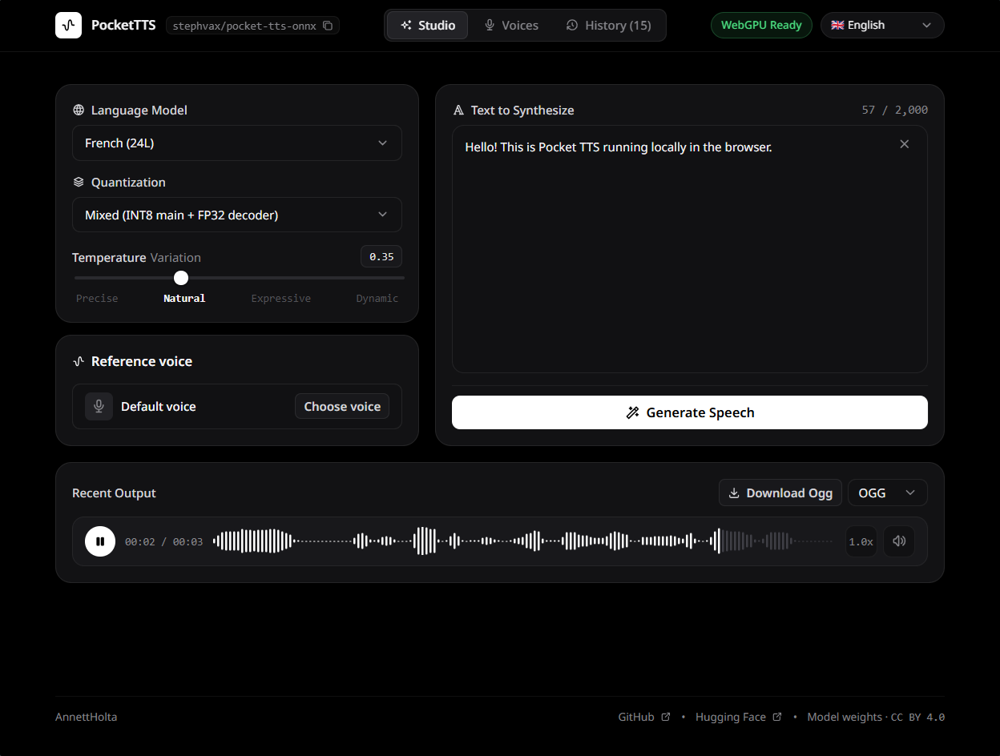

# PocketTTS WebUI

Generate speech in your browser with PocketTTS. Pick a language and a voice, enter text, and download the result in your preferred audio format.



## Get started

Install pnpm and a supported Node.js version. The minimum is **Node.js 22.22.2** on the 22.x line. Node.js **24.15.0 or newer on the 24.x line** is recommended, and Node.js 26 or later is also supported by the dependency requirements.

From this project folder, run:

```sh
pnpm install
pnpm dev
```

Open the localhost address printed in the terminal in a recent desktop version of Chrome, Edge, or Firefox. Leave the terminal running while you use the app. On Windows, use `pnpm.cmd` if PowerShell blocks `pnpm`.

Audio compression runs in the browser with `@ffmpeg/core@0.12.10`, which `pnpm install` installs and Vite bundles as WebAssembly. A system FFmpeg installation is unnecessary.

## Generate your first clip

1. In **Studio**, keep the default English model and mixed precision.
2. Leave the sample text in place and click **Generate Speech**. The first run downloads the pinned model files from Hugging Face and can take a few minutes. The local server verifies cached files before first use and repairs corrupt entries on demand.
3. Play the result or use the format selector beside **Download** to export it as **Ogg, Opus, MP3, WAV, or FLAC**.

Studio plays the model's original WAV output. Downloads default to Ogg. The Ogg and Opus options use the same Ogg Opus audio with `.ogg` and `.opus` extensions, respectively. Open **History** to play or download an earlier clip as Ogg Opus, or reuse its settings in Studio.

The app splits long passages automatically at sentence or word boundaries and joins the result into one clip. If a section fails to finish, try rephrasing it. The app can run on CPU through WASM when GPU acceleration is unavailable.

## Use a reference voice

In **Voices**, add a short, clear recording you have permission to use. WAV and FLAC are good starting formats. Add transcript notes to identify what the speaker said, then save it. Select **Use in Studio** to generate with that recording. You can also add a recording directly from Studio.

The browser saves new reference voices and generated speech as Ogg Opus. Uploaded Ogg Opus files are saved directly after a browser decode check. Previously saved Ogg Vorbis voices remain playable. Transcript notes are for your library. When you reuse an old generation whose reference is missing, reattach the original recording or clear the reference to generate with the default voice.

If voice encoding runs out of memory, try a clear excerpt of about **5 seconds**. In a French CPU profile, a 20-second reference used substantially more memory than a 5-second sample. Memory use varies by model, precision, and browser.

History and saved voices belong to this browser profile and site address. Clearing site data removes them. Download anything you want to keep. Older history entries can still restore their settings, and their audio is available only if it was saved.

The app processes your text and recordings on your device. Internet access is needed to fetch models and runtime assets on first use. Audio encoding runs locally.

## Production build

After installing the dependencies, run:

```sh
pnpm build
pnpm start
```

The server uses `http://127.0.0.1:3001` by default. Keep `dist/assets/` with the rest of the build so the browser can load the FFmpeg worker and WASM binary.

For a hosted demo or downloadable build, include the applicable license notices and provide access to the corresponding source and build scripts for the exact FFmpeg WASM binary you distribute. [FFmpeg build documentation](https://ffmpegwasm.netlify.app/docs/contribution/core/) · [GNU GPL distribution guidance](https://www.gnu.org/licenses/gpl-faq.en.html#DistributeWithSource)

## Generation API

`POST /api/v1/generate` runs on the machine hosting PocketTTS and returns a WAV file. Open the [Scalar API reference](http://127.0.0.1:3001/api/v1/docs) to browse and try the endpoint, or use the [OpenAPI JSON](http://127.0.0.1:3001/api/v1/openapi.json) with other tools. With `pnpm dev`, use the same paths on the URL Vite prints. The Scalar page loads its UI bundle from jsDelivr.

Agents with an HTTP client can follow [`/llms.txt`](http://127.0.0.1:3001/llms.txt) for request examples and instructions for uploading reference audio and saving the generated WAV.

```sh
curl --fail-with-body http://127.0.0.1:3001/api/v1/generate \
  -H 'Content-Type: application/json' \
  --data '{"text":"Hello from PocketTTS."}' \
  --output speech.wav
```

To use a custom voice, send the reference as an Ogg audio file, including `.opus` files in the Ogg container. References can be up to 8 MiB and 20 seconds. The server decodes the clip with the bundled FFmpeg WASM and uses it for that generation.

```sh
curl --fail-with-body http://127.0.0.1:3001/api/v1/generate \
  --form-string 'text=Hello from PocketTTS.' \
  --form 'reference=@sample.opus' \
  --output speech.wav
```

The API defaults to English, INT8, and the `auto` backend. Auto tries native WebGPU when available and falls back to CPU if WebGPU fails. Set `backend` to `cpu` to force CPU inference or `webgpu` to require the WebGPU provider. The `X-Inference-Backend` response header reports the selected provider. The first request for a model may take longer while the server populates its model cache.

The API runs one generation at a time and returns HTTP 429 if it is busy. The default localhost listener is intended for local clients. Browser-saved voices are available in the WebUI, and API requests supply their own references.

## Docker

Start the production build with Docker Compose.

```sh
docker compose up --build
```

Open `http://127.0.0.1:3001`. Set `POCKET_TTS_PORT` in your environment or a local `.env` file to use a different host port. The `model-cache` volume keeps downloaded models across container restarts. History and saved voices live in the browser for that address.

To use Docker directly, build and run the image with a named model volume.

```sh
docker build -t pocket-tts-webui .
docker run --rm -p 127.0.0.1:3001:3001 -v pocket-tts-models:/app/public/models/pocket-tts pocket-tts-webui
```

## Licenses

- The original PocketTTS WebUI source uses Apache License 2.0. [License text](LICENSE)
- Kyutai’s Pocket TTS source code uses MIT. [Kyutai’s license](https://github.com/kyutai-labs/pocket-tts/blob/main/LICENSE)
- The Pocket TTS model weights are © Kyutai and use CC BY 4.0. The app downloads stephvax’s ONNX conversions, which carry the same license. [Kyutai model card](https://huggingface.co/kyutai/pocket-tts) · [ONNX export attribution](https://huggingface.co/stephvax/pocket-tts-onnx#licence-and-attribution) · [CC BY 4.0](https://creativecommons.org/licenses/by/4.0/)
- The bundled FFmpeg WebAssembly core uses GPL-2.0-or-later. [Package license](https://github.com/ffmpegwasm/ffmpeg.wasm/blob/main/packages/core/package.json)
